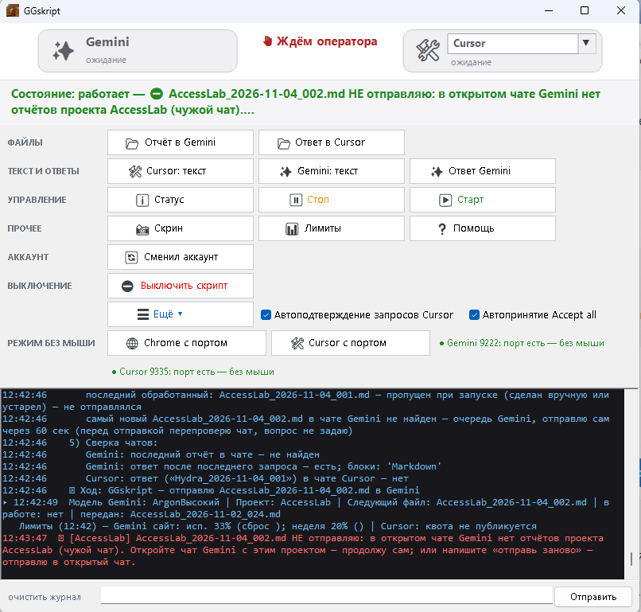

# GGskript v2

Лицензия: [GNU GPL v3.0](LICENSE).

## Зачем это нужно

13 октября 2026 года Google выпустил свою старшую модель **Gemini 4 Argon**. Подписчикам **Google AI Pro** она доступна в приложении Gemini в браузере, с контекстным окном в 1 млн токенов (1 048 576), а в режиме **Argon High** она рассуждает глубже всего. В IDE **Google Antigravity** Argon по той же подписке Pro недоступен: там он открыт только для подписки Ultra. Зато в Antigravity у Pro большие лимиты на младшую модель **Gemini 3.8 Flash (High)**.

GGskript связывает браузерную модель **Argon** (Chrome CDP порт **9222**) с **моделью-исполнителем** в IDE. IDE выбирается настройкой `AgTarget` и выпадающим списком на плитке «ход»:

| IDE | `AgTarget` | Порт CDP |
|---|---|---|
| Antigravity | `antigravity` | 9333 |
| DeepSeek Harness | `dsharness` | 9334 |
| Cursor | `cursor` | 9335 |
| *(Gemini в Chrome)* | — | 9222 |

Встроенный порт DeepSeek Harness 9230 не используется — только 9334 (запуск `--remote-debugging-port=9334 --remote-allow-origins=*`).

Цикл:

1. **Argon** держит план и пишет задание исполнителю одним блоком Markdown (см. [маркеры v4](#маркеры-задания-argon--исполнитель-v4)).
2. **GGskript** копирует блок в чат выбранной IDE.
3. **Исполнитель** правит код и кладёт отчёт `Project_YYYY-MM-DD_NNN.md` в «Загрузки» (любой префикс проекта).
4. **GGskript** при активной модели Argon прикрепляет отчёт в Gemini и жмёт Send; если Gemini переключился на Flash/FlashLite — **STOP** и Telegram «лимит Argon закончен, модель переключена».
5. **Argon** аудирует отчёт и выдаёт следующий шаг или переделку.

По умолчанию оконный режим выключен (`AllowWindowMode=$false`, `GeminiCdpFallback=$false`): без CDP воркер не перехватывает фокус, клавиатуру, мышь и буфер.

**Telegram (по желанию).** К этой связке можно подключить Telegram-бота, но это не обязательно: без токена бота GGskript просто не пишет в Telegram, а управлять им можно с панели на ПК. Бот позволяет удалённо следить за тем, что происходит на компьютере, запрашивать скриншоты и отправлять команды, например «Стоп», «Старт» или «отправь заново». Как его настроить, описано в разделах «Первая настройка» и «Telegram».

Подробности о модели: [Gemini 4 Argon в блоге Google](https://blog.google/innovation-and-ai/models-and-research/gemini-models/introducing-gemini-4-argon/), [документация Gemini API](https://ai.google.dev/gemini-api/docs/models/gemini-4-argon).

## Как устроено

Управление: панель на ПК (ярлык **GGskript** на рабочем столе) и Telegram-бот **@YourBot** (только из чата владельца).
Язык: Windows PowerShell 5.1, для работы ничего ставить не нужно; для тестов — Pester 5.9.1 (см. «Тесты»).

Папка проекта в примерах: `C:\Tools\GGskript` (может быть любой — все пути считаются от папки, где лежит `GGskript.ps1`).

## Что нового с прошлой публикации

Прошлая публикация на GitHub — 22.10.2026 (пункт 53, коммит `570d3a5`). С тех пор (подробно — [CHANGELOG.md](CHANGELOG.md)):

- **Cursor** — третья IDE (CDP 9335, кнопка «🛠 Cursor с портом»); подписи кнопок, журнала и Telegram подставляют имя выбранной IDE.
- **Выпадающий список IDE** на правой плитке индикатора хода (в стиле браузерного combobox ▼), только при «⏸ Стоп»; в Telegram — `ide antigravity|harness|cursor`.
- **Любой проект**: отчёты `ЛюбойПроект_YYYY-MM-DD_NNN.md`, проекты с пробелом в имени.
- **Промпты Argon v4 / Flash**: step id, «конец задания», «Сформулируй отчет …md», акт исполнителя; номер шага берётся и из имени отчёта в тексте просьбы Gemini.
- **NoFocus по умолчанию**: без CDP скрипт не перехватывает фокус, мышь, клавиатуру и буфер.
- **Несколько вкладок/аккаунтов Gemini** (`/u/N`): выбор вкладки по признакам, лимиты того же аккаунта, кнопка **🔄 Сменил аккаунт**, проверка аккаунта раз в минуту на остановке по лимиту.
- **Защита от чужого чата Gemini** (`ForeignChatGuard`).
- **Accept all** нажимается сразу, как только кнопка найдена (и во время работы агента), с антидребезгом.
- **Исправлена отправка файла** с обрезанным именем чипа; проверка, что запрос с файлом действительно ушёл.
- **Панель**: строка состояния с переносом, цветной журнал, ссылка «очистить журнал», чистый журнал при каждом запуске (`logs\`, последние 10).
- **Новая серия шагов** (02.11): новый день/чат с нумерацией `_001` больше не упирается в учёт прошлой серии.
- Тесты: Item54–Item65.

## Внешний вид



Панель GGskript: сверху — индикатор **«чей ход»** (плитки Gemini и текущей IDE, анимированная стрелка). Клик по правой плитке при «⏸ Стоп» открывает выбор IDE (Antigravity / DeepSeek Harness / Cursor). Ниже — модель Gemini, файл/этап, лимиты; кнопки; журнал; поле команд. На скриншоте выбрана IDE Cursor, сработала защита от чужого чата Gemini.

**Кнопки на главной панели** (часть дублируется в Telegram):

| Группа | Кнопки |
|---|---|
| Файлы | 📂 Отчёт в Gemini · 📂 Ответ в IDE (с подтверждением; подпись зависит от выбранной IDE) |
| Текст и ответы | 🛠 IDE: текст · ✨ Gemini: текст · ✨ Ответ Gemini |
| Управление | ℹ️ Статус · ⏸ Стоп · ▶️ Старт · **⛔ Выключить скрипт** (красная, с подтверждением — гасит воркер) |
| Прочее | 📸 Скрин · 📊 Лимиты · ❓ Помощь (открывает `docs\HELP.txt` в Блокноте, если его нет — `README.md`; список команд также уходит в Telegram) |

Флажок автоподтверждения запросов IDE — на виду. В **☰ Ещё**: Accept all, передать ответ / всё равно, автоподтверждение, авто-закрытие окон, выключение ПК (когда/отмена — только из Telegram), открыть папку, снова «Выключить скрипт».

## Промпты — часть системы (обязательно)

GGskript — только транспорт: он переносит текст и файлы между Gemini и IDE, но сам не решает, что писать моделям. Формат обмена задают два системных промпта из папки [prompts/](prompts/). Без них цикл не работает: Argon выдаст задание без нужного заголовка, исполнитель сохранит отчёт под другим именем или в другую папку, и GGskript не поймёт, чей ход и какой файл передавать.

| Файл | Кому | Когда | Что задаёт |
|---|---|---|---|
| [prompts/ARGON_SYSTEM_PROMPT.md](prompts/ARGON_SYSTEM_PROMPT.md) | Gemini (модель **Argon**), браузер | Первым сообщением в **каждом новом** чате Gemini | Регламент старшей модели: ответ пользователю на русском (аудит отчёта, статус плана), затем **ровно один** блок ` ```markdown ` в самом конце ответа с заданием исполнителю на английском (без обратных кавычек и `...` внутри; шаг ≤ 3–4 разрешённых файлов, ≤ 3 подзадачи, ≤ 70 строк; фиксированная структура разделов) |
| [prompts/FLASH_SYSTEM_PROMPT.md](prompts/FLASH_SYSTEM_PROMPT.md) | Агент IDE (Antigravity / DeepSeek Harness / Cursor) | Первым сообщением в **каждом новом** чате агента | Регламент исполнителя: только разрешённые файлы, конечные таймауты, без заглушек и вымышленных данных; полный отчёт на английском — в `Downloads\<Project>_<YYYY-MM-DD>_<NNN>.md`, в чате — короткий акт на русском |

### Контракт, на который опирается код

Требования ниже взяты из кода (`lib\Core.ps1` — `Pattern`, `CodeBlockLang`, `ModelMustContain`; `lib\State.ps1` — `Get-PromptHeader`, `Get-AskedReportFromText`, `Get-BlockAsk`, `Get-ReportCandidates`, `Get-JuniorActDone`, `Test-ChatHasProjectReports`). Если меняете промпты — не ломайте эти пункты.

1. **Блок задания.** GGskript берёт **последний** блок кода в ответе Gemini с подписью из `CodeBlockLang` (по умолчанию `Markdown,XML`). Нет такого блока — 2 коротких сигнала, ничего не передаётся.
2. **Номер шага и проект** (`Get-BlockAsk`, по порядку):
   - **заголовок** в первых 4 строках блока: `[…] [Project] [S<N>] […]`, для переделки — `[Project] [REWORK S<N>]` (regex `\[(?<project>[^\[\]>]+)\]\s*\[\s*(REWORK\s*)?S(?<n>\d{1,4})\s*\]`). Имя проекта может содержать одиночные пробелы («Fishka 2»);
   - иначе **step id** (формат промпта Argon v4) отдельной строкой в первых 6 строках: `Project_YYYY-MM-DD_NNN` (можно с `.md`), имя проекта без пробелов;
   - иначе **имя отчёта в тексте**: `Project_YYYY-MM-DD_NNN.md` где угодно в ответе (берётся наибольший номер).
   Без номера шага ход не определяется и блок не передаётся автоматически.
3. **Конец задания** (Argon v4): последние две строки блока — `конец задания` и `Сформулируй отчет Project_YYYY-MM-DD_NNN.md` с реальным, раскрытым именем. Старые метки `[ARGON>FLASH]` / `[[END SNNN]]` ещё принимаются.
4. **Имя файла отчёта** — строго `^(?<project>[^\\/:*?"<>|]+?)_(?<date>\d{4}-\d{2}-\d{2})_(?<n>\d{3,})\.md$`, например `Hydra_2026-11-04_001.md`. Номер — 3+ цифры, совпадает с номером шага.
5. **Папка** — «Загрузки» текущего пользователя Windows (`%USERPROFILE%\Downloads`, настройка `Downloads`). Других `.md` с таким шаблоном туда класть не нужно.
6. **Имя проекта должно совпадать** в заголовке/step id блока, в имени отчёта и в отчётах, уже отправленных в этот чат Gemini (сравнение без учёта регистра). По нему выбирается активный проект, очередь и защита от «чужого чата».
7. **Акт исполнителя** в чате IDE заканчивается строкой `Отчет <имя>.md создан и лежит в папке <путь>` — так GGskript видит, что исполнитель закончил (`Get-JuniorActDone`).
8. **Модель.** Отчёт прикрепляется в Gemini и отправляется только когда выбрана модель, содержащая `ModelMustContain` (`Argon`).

**Путь к «Загрузкам» можно поменять.** В промптах он записан как `C:\Users\user\Downloads`. Если ваш пользователь Windows называется иначе или отчёты должны лежать в другой папке, отредактируйте этот путь в обоих файлах — `prompts\ARGON_SYSTEM_PROMPT.md` и `prompts\FLASH_SYSTEM_PROMPT.md` (модель должна писать реальный, а не шаблонный путь). Если папка не стандартная «Загрузки», укажите ту же папку в `relay_settings.json`, ключ `Downloads` (по умолчанию `%USERPROFILE%\Downloads`), — иначе GGskript будет искать отчёты в другом месте.

## Документация

| Документ | О чём |
|---|---|
| [docs/HELP.txt](docs/HELP.txt) | Справка для пользователя (открывается кнопкой «❓ Помощь» в Блокноте) |
| [CHANGELOG.md](CHANGELOG.md) | Что менялось по датам, что нового с прошлой публикации |
| [docs/CURRENT.md](docs/CURRENT.md) | Снимок возможностей на 2026-11-04 (IDE, порты, маркеры, лимиты, аккаунты, защиты, тесты) |
| [docs/ARCHITECTURE.md](docs/ARCHITECTURE.md) | Компоненты, поток данных, цикл передачи, этапы файла, протокол запуска, связи с внешним миром, безопасность |
| [docs/CODE_MAP.md](docs/CODE_MAP.md) | Каждый файл и папка: назначение, ключевые функции, какие файлы — рабочее состояние |
| [docs/DEPENDENCIES.md](docs/DEPENDENCIES.md) | Граф зависимостей между файлами и внешние зависимости |
| [prompts/](prompts/) | Системные промпты для Argon и Flash, без них связка не работает |
| [docs/history/PLAN.md](docs/history/PLAN.md) | История плана v2 (пункты 1+); актуальный снимок — CURRENT.md |

## Как это работает (коротко)

1. Исполнитель в выбранной IDE сохраняет отчёт `AnyProject_YYYY-MM-DD_NNN.md` в `%USERPROFILE%\Downloads`.
2. GGskript ждёт стабильный файл, проверяет лимиты и что модель Gemini — **Argon**, затем прикрепляет файл (не шлёт повторно уже вложенный chip; усечённые имена — `Test-ChipMatchesName`).
3. Ждёт ответ Argon, берёт **последний блок** с подписью из `CodeBlockLang` (по умолчанию Markdown,XML). Парсит step id / «конец задания» / имя отчёта (или legacy `[ARGON>FLASH]`).
4. Вставляет блок в чат IDE (Antigravity / Harness / Cursor). Ход: если Gemini просит отчёт N, а в Downloads есть N−1 — сначала IDE (`Get-AskedReportFromText`).
5. Telegram (опционально) и панель; FlashLite → остановка без attach.

## Пошаговый запуск

### 1. Установить программы
- Windows 10/11 с **Windows PowerShell 5.1** (уже есть в системе; PowerShell 7 не нужен). Если скачивали ZIP — разблокировать файлы: `Get-ChildItem <папка> -Recurse | Unblock-File`.
- **Google Chrome** — для Gemini.
- Хотя бы одну IDE с агентом: **Google Antigravity**, **DeepSeek Harness** или **Cursor**. Войти в аккаунт внутри IDE, проверить, что агент отвечает.
- По желанию: Telegram-бот (токен от @BotFather) и Pester 5.9.1 для тестов.
- Сделать копии настроек из `*.example.json` и ярлык на `GGskript_launch.vbs` (см. «Установка»).

### 2. Gemini: аккаунт и модель Argon
- Нужен аккаунт Google с подпиской, где доступна модель **Argon** (Google AI Pro и выше).
- Вход в Google делается в **отдельном** Chrome GGskript (шаг 3) — у него свой профиль, вход в обычном Chrome туда не переносится. Войти один раз, дальше профиль помнит вход.
- В чате Gemini в переключателе моделей выбрать **Argon** (лучше режим High). Если Argon не выбран, GGskript отчёт не отправит.

### 3. Запуск
1. Запустить GGskript **ярлыком** (`GGskript_launch.vbs`). Откроется панель; воркер стартует в фоне. Если до этого был «Стоп» — скрипт остаётся в «Стоп».
2. На плитке хода справа (при «⏸ Стоп») выбрать IDE: Antigravity / DeepSeek Harness / Cursor.
3. Chrome и IDE запускать **не вручную, а кнопками панели**: **🌐 Chrome с портом** (порт 9222) и **🛠 <IDE> с портом** (9333 / 9334 / 9335). Обычный запуск ярлыком IDE или Chrome не включает порт отладки, и GGskript их «не увидит». Кнопка IDE перезапускает её с портом (спросит подтверждение). Индикаторы портов на панели должны стать зелёными.
4. Открыть нужные чаты (шаг 4) и нажать **▶️ Старт**. Скрипт выполнит протокол запуска (порты, лимиты, модель, файлы, чей ход) и начнёт работу.

### 4. Перед каждой новой задачей — новые чаты и промпты
1. В Gemini открыть **новый** чат, выбрать Argon и первым сообщением прикрепить или вставить [prompts/ARGON_SYSTEM_PROMPT.md](prompts/ARGON_SYSTEM_PROMPT.md), затем описать задачу и имя проекта.
2. В IDE открыть **новый** чат агента и первым сообщением прикрепить или вставить [prompts/FLASH_SYSTEM_PROMPT.md](prompts/FLASH_SYSTEM_PROMPT.md).
3. Удобно открыть оба файла в Блокноте (`notepad prompts\ARGON_SYSTEM_PROMPT.md`), скопировать всё (Ctrl+A, Ctrl+C) и вставить в чат, или прикрепить файл кнопкой вложения.

Зачем: GGskript опирается на контракт из промптов — заголовок/step id блока задания, имя отчёта `Project_YYYY-MM-DD_NNN.md` в «Загрузках» и строку акта исполнителя (см. «Промпты — часть системы»). Старый чат с другим проектом скрипт считает «чужим» и не шлёт в него отчёты; в новом чате нумерация шагов начинается с `_001`, и скрипт распознаёт это как новую серию шагов.

## Запуск и остановка

| Действие | Как |
|---|---|
| Запустить | Ярлык **GGskript** на рабочем столе (→ `GGskript_launch.vbs` → панель `GGskript_gui.ps1` → скрытый воркер `GGskript.ps1`). Или `GGskript.bat` — воркер в консоли без панели. |
| Стоп (процесс жив, слушает Telegram, окна и лимиты не трогает) | Кнопка «Стоп» в панели / в Telegram / файл `PAUSE` в папке проекта / клавиша **P** в консоли |
| Старт (снять стоп; сначала протокол запуска) | Кнопка «Старт» / «Старт» в Telegram / удалить `PAUSE` / клавиша **S** / ещё раз ярлык |
| Выключить скрипт совсем | Кнопка «Выключить скрипт» / «Выключи скрипт» в Telegram (с подтверждением) / `GGskript_exit.bat` (создаёт файл `STOP`) / Ctrl+C в консоли |
| Закрыть панель (крестик) | Вопрос: **Да** — остановить передачу (воркер выключается), **Нет** — закрыть только окно, передача идёт в фоне, **Отмена** — ничего |
| Команда с ПК без Telegram | `GGskript_cmd.bat` или поле внизу панели (пишет строку в `commands.txt`) |
| Автоподтверждение запросов Antigravity | Флажок «Автоподтверждение запросов Antigravity» в панели / `автоподтверждение вкл` и `автоподтверждение выкл` в Telegram или в поле панели |

**Автоподтверждение.** Когда агент Antigravity спрашивает разрешение (панель «Allow running … ?» с вариантами «Yes, allow this time», «Yes, and always allow …», «No …» и кнопками Skip / Submit), GGskript при включённом флажке сам выбирает **только** вариант «Yes, allow this time» и нажимает **Submit**. Варианты «always», «No», кнопки Skip, Cancel, Reject и Stop он не нажимает никогда, даже если шаблоны в настройках расширены. Проверка идёт раз в `AutoAllowEverySec` секунд (по умолчанию 3), и в простое, и во время ожидания ответа Gemini, в том числе в режиме «Стоп». Окно не активируется: в режиме CDP (порт 9333) клик идёт в DOM, без порта — через UI Automation (SelectionItem/Invoke), мышью без фокуса не жмёт. Каждое подтверждение пишется одной строкой в журнал. Диагностика без нажатий: `GGskript.bat -testallow` показывает, что UIA видит в окне Antigravity. Состояние хранится в `relay_settings.json` (`AutoAllowPrompts`, по умолчанию `false`) и меняется на лету, без перезапуска воркера.

Запускается только один воркер (мьютекс `Local\GGskript_Worker`) и одна панель (`Local\GGskript_GUI`). Если скрипт был в режиме «Стоп» (есть файл `PAUSE`), после запуска он остаётся в «Стоп» — нажмите «Старт».

## Требования

- Windows 10/11, Windows PowerShell 5.1 (входит в Windows).
- IDE с агентом: Google Antigravity, DeepSeek Harness или Cursor; браузер для Gemini: Google Chrome (рекомендуется), Яндекс Браузер или Microsoft Edge.
- Аккаунт Google с доступом к модели Gemini **Argon**.
- По желанию: Telegram-бот (токен от @BotFather) для удалённого управления, уведомлений и скриншотов.
- Для тестов: модуль Pester 5.9.1; для фонового режима — Google Chrome.

## Установка

1. Скачать проект: `git clone <адрес репозитория> C:\Tools\GGskript` или «Code → Download ZIP» на GitHub и распаковать в любую папку.
2. Если скачивали ZIP — снять пометку «из интернета», иначе PowerShell может блокировать скрипты:
   `Get-ChildItem C:\Tools\GGskript -Recurse | Unblock-File`
3. Скопировать образцы настроек: `relay_config.example.json` → `relay_config.json`, `relay_settings.example.json` → `relay_settings.json` (в `relay_settings.json` оставить только то, что хотите поменять).
4. По желанию, если нужен Telegram, сохранить токен бота: `powershell -ExecutionPolicy Bypass -File Set-TgToken.ps1` (подробнее — «Первая настройка»).
5. Создать ярлык на рабочем столе: объект `wscript.exe "C:\Tools\GGskript\GGskript_launch.vbs"`, рабочая папка `C:\Tools\GGskript`, значок `C:\Tools\GGskript\GGskript.ico`.

Личные файлы (`tg_token.dpapi`, `relay_config.json`, `relay_settings.json`, учёт `relay_state.json`, журнал, `PAUSE`/`STOP`) создаются у вас локально и в git не попадают (см. `.gitignore`).

## Первая настройка

1. **Telegram.** `powershell -ExecutionPolicy Bypass -File Set-TgToken.ps1` — вставить токен бота (ввод скрыт). Токен шифруется Windows DPAPI в `tg_token.dpapi` и расшифровывается только под этой учётной записью Windows на этом ПК. В `relay_config.json` — `telegram_username` (без @); `chat_id` заполнится сам после `/start` боту.
2. **Настройки.** Значения по умолчанию — в `lib\Core.ps1` (`Get-DefaultSettings`). Свои — в `relay_settings.json` (только изменённые ключи, пример — `relay_settings.example.json`). Неизвестные ключи и неверные типы пропускаются с предупреждением в журнале.

### Фоновый режим без переключения окон (CDP) — один раз

В обычном режиме (`uia`) GGskript выводит окна на передний план, вставляет текст через буфер обмена и клавиатуру. В фоновом режиме (`cdp`) он работает с браузером и Antigravity через порт отладки (Chrome DevTools Protocol): без фокуса, клавиатуры и буфера, и вы можете работать на том же экране.

1. Запустить `Start-GeminiChrome.bat` — откроется **отдельный** Google Chrome (профиль `%LOCALAPPDATA%\GGskript\chrome-gemini-profile`, порт `127.0.0.1:9222`) с вкладками чата Gemini и `https://gemini.google.com/usage`. Войти в Google, открыть нужный чат Gemini, вкладку usage не закрывать. Окно можно свернуть.
   (`Start-GeminiBrowser.bat [порт] [chrome|yandex|edge]` — запасной вариант: без аргумента тоже открывает Chrome, `yandex` — Яндекс Браузер (профиль `%LOCALAPPDATA%\GGskript\gemini-profile`), `edge` — Microsoft Edge (`edge-gemini-profile`).)
   Ссылки из Telegram открываются в браузере по умолчанию — адрес usage вставляйте прямо в окне этого Chrome (Ctrl+T).
2. Antigravity: «File → Exit», затем `Start-Antigravity-Debug.bat` (порт `127.0.0.1:9333`).
3. **Снова открыть последнюю беседу агента**: значок часов (история) справа вверху → последняя беседа → «Open in current window».
4. В `relay_settings.json`: `"GeminiTransport": "cdp"` и `"AgTransport": "cdp"`.
5. Проверка (только чтение): `GGskript.bat -testcdp`. Потом запуск ярлыком.

Если порт недоступен (браузер/Antigravity запущен обычным способом), GGskript один раз сообщает в Telegram и временно работает по-старому через окно (`GeminiCdpFallback`, `AgCdpFallback`).

## Лимиты, модель и аккаунты

| Ситуация | Что делает GGskript |
|---|---|
| Gemini переключился с **Argon** на Flash / Flash-Lite (кончился лимит Argon) | Отчёт **не** прикрепляется, ответ не-Argon в IDE не передаётся. Остановка по лимиту (`Enter-LimitStop`), 1 длинный сигнал, Telegram «лимит Argon закончен, модель переключена». После сброса лимита (`AutoResume`) сам перепроверяет, возвращает Argon (`AutoSwitchModel`) и продолжает |
| Лимит сайта Gemini | Стоп только при полном исчерпании (`GeminiWebThreshold=100`, % использовано); лимиты читаются со вкладки `/usage` **того же** аккаунта, что и чат |
| Лимит Antigravity | Стоп, когда осталось **1%** или меньше (`AgThreshold=1`, группа `Gemini Models`); лимит одной стороны блокирует только передачу в эту сторону |
| DeepSeek Harness / Cursor | Квоту не публикуют; ошибка 429 — только предупреждение в Telegram |
| Смена аккаунта Google | Аккаунт определяется по адресу вкладки (`gemini.google.com/u/N/…`, без `/u/` — 0). Кнопка **🔄 Сменил аккаунт** сбрасывает соединение с Gemini, заново выбирает вкладку, перечитывает лимит и модель и, если всё в норме, снимает остановку. На остановке по лимиту скрипт сам раз в минуту проверяет аккаунт и доступность Argon (`AccountWatch`) |
| «▶️ Старт» на остановке по лимиту | Продолжить, игнорируя лимит |

## Защиты

- **Чужой чат Gemini** (`ForeignChatGuard`): если в открытом чате нет ни одного отчёта текущего проекта, отчёт не отправляется — вопрос на панели и в Telegram. Исключения: шаг 001 и «отправь заново».
- **Чужой текст в поле IDE**: если в поле ввода агента уже есть текст (или он меняется — кто-то печатает), GGskript его не трогает и не отправляет; повтор через `AgForeignRetrySec`.
- **Агент занят**: пока агент IDE работает (кнопка Stop/Cancel), отчёт в Gemini не отправляется и новый блок не вставляется.
- **Новая серия шагов** (02.11): блок с новым содержимым и номером меньше последнего переданного, или отчёт, записанный позже последней передачи, начинает новую серию — старые записи учёта помечаются `old-`.
- **Accept all**: кнопка «Accept all» агента нажимается сразу, как только найдена (`AutoAcceptAll`, `AcceptAllWhileBusy`), только через CDP по точному тексту, не чаще раза в `AcceptAllMinGapSec` (20 с); Cancel/Reject исключены.
- **Автоподтверждение** запросов IDE: только «Yes, allow this time» + Submit (Antigravity) или Run/Allow (Cursor), никогда «always» / No / Skip / Cancel.

## Telegram

Кнопки под полем ввода (по-русски, отправляют свой текст как команду):

`Статус | Стоп | Старт` · `Прими | Передай ответ | Передай всё равно` · `Перешли ответ в Antigravity | Перешли отчёт в Gemini` · `Что ответил Джемини | Отправь заново | Выключи скрипт` · `Напиши | Скрин | Лимиты | Помощь`

Основные команды (полный список — «помощь» или `$HelpText` в `lib\Relay.ps1`):

| Команда | Что делает |
|---|---|
| `статус` (`/status`) | Состояние, лимиты, следующий файл, последние строки журнала |
| `стоп` (`/stop`, `пауза`) | Режим «Стоп» |
| `старт` / `продолжай` (`/resume`) | Протокол запуска, затем работа; при остановке по лимиту — игнорировать лимит |
| `выключи скрипт` (`/exit`) | Завершить процесс (с подтверждением); запустить снова — только на ПК |
| `прими` (`/accept`) | Нажать «Accept all» в агенте IDE |
| `автопринятие вкл` / `выкл` | Автонажатие «Accept all» (`AutoAcceptAll`) |
| `ide antigravity` / `ide harness` / `ide cursor` (`/ide …`) | Выбрать IDE (только при Стоп); без слова — показать текущую |
| `автоподтверждение вкл` / `выкл` (`/autoallow on`/`off`) | Включить/выключить автоподтверждение запросов разрешения Antigravity («Yes, allow this time» + Submit); без слова — показать состояние |
| `джемини: текст` (`/gemini`) / `антигравити: текст` (`/ag`) | Отправить свой текст в Gemini / в Antigravity |
| `передай ответ` / `передай весь ответ` | Передать блок Markdown последнего ответа / весь ответ |
| `передай всё равно` (`/force`), `отправь заново` (`/resend`) | Решения по ответу, совпавшему со старым |
| `перешли ответ в Antigravity` (`/toag`), `перешли отчёт в Gemini` / `передай файл в гемини` (`/togemini`) | Ручная пересылка с подтверждением |
| `напиши` (`/send`) | Бот попросит текст и спросит, куда отправить |
| `что ответил джемини` (`/answer`) | Прислать последний ответ Gemini |
| `скрин` (`/shot`), `лимиты` (`/limits`) | Снимок экрана; проверить лимиты сейчас |
| `выключи компьютер [в 14-00 \| через 30 минут]` (`/shutdown`), `отмени выключение` | Выключение ПК, всегда с подтверждением |

Подписи «Antigravity» в кнопках и справке бота заменяются именем выбранной IDE.

Меню «/» в Telegram — латинские команды (`setMyCommands`, задаётся один раз, не кодом скрипта). Команды принимаются только от владельца: `chat_id` из `relay_config.json`.

## Звуки на ПК

| Сигнал | Значение |
|---|---|
| 1 длинный низкий | Работа остановлена: лимит или в Gemini не та модель |
| 2 коротких | В ответе Gemini нет блока «Markdown» |
| 3 коротких | Нужна ваша помощь (ошибка) |
| 1 короткий высокий | Ответ передан в Antigravity (только при `Sounds=all`) |

Один и тот же сигнал — не чаще раза в 10 минут (`SoundRepeatMin`). Настройка `Sounds`: `important` (по умолчанию) | `off` | `all`.

## Проверочные режимы (ничего не отправляют)

Запуск: `GGskript.bat <ключ>` или `powershell -NoProfile -STA -ExecutionPolicy Bypass -File GGskript.ps1 <ключ>`.

| Ключ | Что показывает |
|---|---|
| `-teststart` | Протокол запуска «всухую»: окна, лимиты, модель, файлы, чей ход |
| `-testcdp` | Вкладки CDP-браузера Gemini, модель, последний отчёт в чате; цели CDP Antigravity |
| `-testallow` | Что UIA видит в окне Antigravity из запроса разрешения (варианты allow, Submit, Skip); ничего не нажимает |
| `-check` | Какие файлы в «Загрузках» обработаны, какие будут взяты |
| `-testgemini`, `-testag` | Окно Gemini / Antigravity через UIA (без кликов) |
| `-testquota [-web]`, `-testplan` | Лимиты Antigravity (и сайта Gemini), план автовозобновления |
| `-testmodel` | Текущая модель и пункты меню моделей (меню открывается и закрывается) |
| `-testtg`, `-teststatus`, `-testparse` | Telegram, текст статуса, разбор команд |

`-testpaste`, `-testcopy`, `-testmodel -switch`, `-testtg -send` — **трогают** окна/буфер/Telegram, используйте осознанно.

## Тесты

Pester в репозиторий не входит. Один раз установить:

```
Install-Module Pester -RequiredVersion 5.9.1 -Scope CurrentUser -Force -SkipPublisherCheck
```

Запуск:

```
powershell -NoProfile -ExecutionPolicy Bypass -File Run-Tests.ps1 -Safe     # на ПК: без побочных эффектов
pwsh -File Run-Tests.ps1                                                   # всё (Linux/CI: WindowsOnly пропускаются)
pwsh -File Run-Tests.ps1 -Tag Item29                                       # один пункт плана
powershell -NoProfile -File tools\Test-Syntax.ps1                          # синтаксис и UTF-8 BOM всех .ps1 (PowerShell 5.1)
```

`Run-Tests.ps1` берёт Pester из `tools\Pester`, если там есть локальная копия (в git она не входит), иначе — установленный модуль 5.5–5.99.
Тесты подменяют буфер обмена, Telegram, скриншоты, shutdown.exe «предохранителями» (	ests\_Load.ps1) — звонков наружу и звуков нет.

Актуально: файлы `Item01`…`Item66`. Последний прогон `Run-Tests.ps1 -Safe` (04.11.2026, копия для публикации): **1302** обнаружено, **1261** пройдено, **0** упало, **41** не запускались (Integration/LinuxOnly). Новые пункты после публикации 22.10: имена IDE (54), Cursor (55), AnyProject (56), NoFocus (57), ask-filename (58), chip/body (59), attach vs mention (60), маркеры Argon v2 (61), tabfix (62), sendfix (63), цвета/аккаунт (64), серия шагов/журнал (65), кнопка «Помощь» (66). Сводка: [docs/CURRENT.md](docs/CURRENT.md).

## Неполадки

| Симптом | Что делать |
|---|---|
| «уже запущен» при запуске | Воркер уже работает (мьютекс). Если был «Стоп» — повторный запуск снимает его. |
| В Telegram нет ответов | `GGskript.bat -testtg`; токен — `Set-TgToken.ps1`; `chat_id` — напишите боту `/start`. После переноса на **другого пользователя Windows** токен нужно ввести заново (DPAPI). |
| `Port 9222 is busy by another program` | Порт занят другим браузером. Закройте тот отдельный браузер GGskript (не свой обычный) и запустите `.bat` снова. |
| «CDP недоступен», работает через окна | Chrome/Antigravity запущены без порта. Повторите шаги фонового режима. |
| Antigravity: «User cancelled agent execution» | Не GGskript: если код проекта агента вызывает `os.kill(pid, 0)`, на Windows это шлёт Ctrl+C всей консоли и отменяет агента. Замена — `psutil.pid_exists(pid)`. |
| Модель не Argon / лимит | Остановка с 1 длинным сигналом; после сброса лимита GGskript сам перепроверит и продолжит (`AutoResume`). «Старт» — игнорировать лимит. |
| Старый отчёт отправился повторно | При запуске берётся только самый новый файл (`StartupNewestOnly`); вручную отправленные узнаются по имени вложения или содержимому (`MatchByContent`). |
| Журнал | `relay_log.txt` — текущий запуск (хвост виден в панели, ссылка «очистить журнал»); прошлые запуски — `logs\relay_log_<дата>_<время>.txt`, последние 10. |

## Перенос в другую папку

Все пути считаются от папки скрипта (`$PSScriptRoot`, `%~dp0`, `WScript.ScriptFullName`), тест `tests\Item29.Paths.Tests.ps1` проверяет, что в коде, запускаторах и настройках нет абсолютного пути к проекту. Чтобы перенести: остановить скрипт, скопировать папку целиком (включая `relay_*.json`, `tg_token.dpapi`, `answers\`), не копировать `STOP`, поправить ярлык на рабочем столе (цель `wscript.exe "<папка>\GGskript_launch.vbs"`, рабочая папка, значок `GGskript.ico`).

## Лицензия

GGskript распространяется по лицензии **GNU General Public License v3.0** (GPL-3.0). Полный текст — в файле [LICENSE](LICENSE).

## IDE: Antigravity, DeepSeek Harness, Cursor

Настройка `AgTarget` в `relay_settings.json` или выпадающий список на плитке хода (только при Стоп).

| IDE | Порт | Модуль | Запуск с портом |
|---|---|---|---|
| Antigravity | 9333 | `Antigravity.ps1` / `Antigravity.Cdp.ps1` | `Start-Antigravity-Debug.bat` |
| DeepSeek Harness | 9334 | `DsHarness.Cdp.ps1` | кнопка «🛠 Harness с портом» |
| Cursor | 9335 | `DsHarness.Cdp.ps1` (`CursorCdpSelDefault`) | «🛠 Cursor с портом» → `Cursor.exe --remote-debugging-port=9335` |

Harness/Cursor — только CDP (мышь/фокус не используются). Cursor: Enter или «Send message»; busy = «Stop generation»; автоподтверждение только Run/Allow (`CursorAllowOptionRx`). Проверка: `GGskript.ps1 -testdsh` / `-testdshsend "текст"` при выбранной IDE. Gemini Chrome: `Start-GeminiChrome.bat`, порт **9222**.

**NoFocus (пункт 57):** `AllowWindowMode` и `GeminiCdpFallback` по умолчанию `false`. Красная **⛔ Выключить скрипт** всегда доступна на панели.
