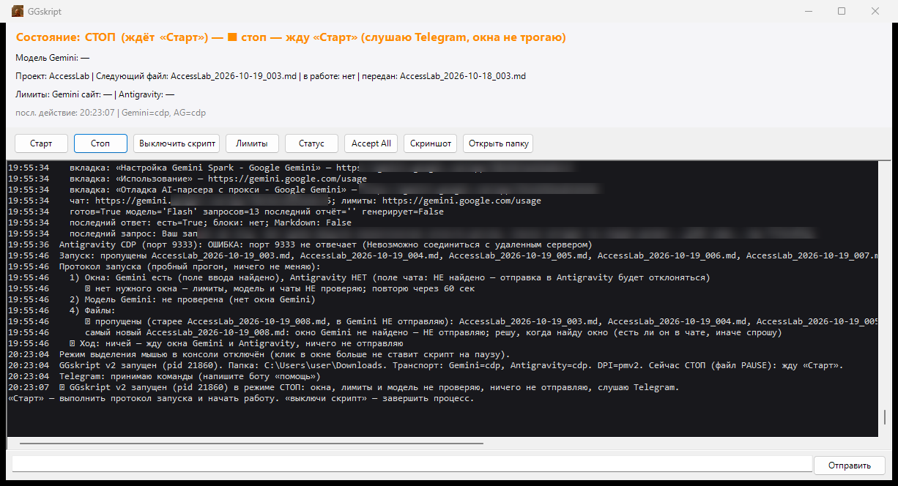

# GGskript v2

Лицензия: [GNU GPL v3.0](LICENSE).

## Зачем это нужно

13 октября 2026 года Google выпустил свою старшую модель **Gemini 4 Argon**. Подписчикам **Google AI Pro** она доступна в приложении Gemini в браузере, с контекстным окном в 1 млн токенов (1 048 576), а в режиме **Argon High** она рассуждает глубже всего. В IDE **Google Antigravity** Argon по той же подписке Pro недоступен: там он открыт только для подписки Ultra. Зато в Antigravity у Pro большие лимиты на младшую модель **Gemini 3.8 Flash (High)**.

GGskript связывает эти две модели в одну работу. Он оркестрирует браузерную модель Argon и модель Gemini Flash, встроенную в Antigravity, так что каждая делает то, что у неё получается лучше:

1. **Argon (старшая модель)** держит план, раздаёт задачи и пишет промпт для исполнителя в виде Markdown-блока.
2. **GGskript** забирает этот промпт и передаёт его в чат агента Antigravity.
3. **Flash (младшая модель)** выполняет задачу и кладёт отчёт в виде `.md`-файла в папку «Загрузки», с датой и порядковым номером в имени, например `MyProject_2026-10-19_003.md`.
4. **GGskript** замечает появление файла, сразу передаёт отчёт в Argon и ждёт следующей инструкции.
5. **Argon** проверяет отчёт: либо заставляет исправить, либо ставит следующую задачу. Цикл повторяется, пока задача не будет выполнена.

Попутно GGskript следит за лимитами и за тем, чтобы Gemini в браузере случайно не переключился с Argon на младшую модель. Если это случилось, работа приостанавливается, пока модель не вернут.

Итог: мощная новая модель руководит и проверяет, а младшая и дешёвая исполняет.

**Telegram (по желанию).** К этой связке можно подключить Telegram-бота, но это не обязательно: без токена бота GGskript просто не пишет в Telegram, а управлять им можно с панели на ПК. Бот позволяет удалённо следить за тем, что происходит на компьютере, запрашивать скриншоты и отправлять команды, например «Стоп», «Старт» или «отправь заново». Как его настроить, описано в разделах «Первая настройка» и «Telegram».

Подробности о модели: [Gemini 4 Argon в блоге Google](https://blog.google/innovation-and-ai/models-and-research/gemini-models/introducing-gemini-4-argon/), [документация Gemini API](https://ai.google.dev/gemini-api/docs/models/gemini-4-argon).

## Как устроено

Управление: панель на ПК (ярлык **GGskript** на рабочем столе) и Telegram-бот **@YourBot** (только из чата владельца).
Язык: Windows PowerShell 5.1, для работы ничего ставить не нужно; для тестов — Pester 5.9.1 (см. «Тесты»).

Папка проекта в примерах: `C:\Tools\GGskript` (может быть любой — все пути считаются от папки, где лежит `GGskript.ps1`).

## Внешний вид



Панель GGskript: состояние и модель Gemini сверху, кнопки управления, журнал работы и поле для команд снизу. Адреса чатов Gemini и текст запроса на скриншоте размыты.

## Промпты для моделей (обязательная часть)

GGskript выполняет транспортную функцию: он передаёт данные между моделями, но не управляет их поведением. Корректность работы связки обеспечивают два системных промпта, которые задают формат обмена и правила исполнения. При их несоблюдении цикл нарушается. Argon может сформировать задание без блока Markdown или с повреждённым блоком, а Flash может не сохранить отчёт или сохранить его под именем, которое GGskript не распознает.

| Файл | Порядок применения | Назначение |
|---|---|---|
| [prompts/ARGON_SYSTEM_PROMPT.md](prompts/ARGON_SYSTEM_PROMPT.md) | Отправляется первым сообщением в чат Gemini с моделью Argon перед началом работы | Регламент старшей модели. Ответ пользователю формируется на русском языке: сначала аудит полученного отчёта, затем статус выполнения плана. Техническое задание для Flash формируется на английском языке в едином блоке Markdown без обратных кавычек внутри. Каждое задание соответствует одному шагу плана и ограничено по объёму: не более 3–4 разрешённых файлов, трёх подзадач и финального шага с тестированием и отчётом, не более 70 строк. Задание имеет фиксированную структуру из XML-блоков. |
| [prompts/FLASH_SYSTEM_PROMPT.md](prompts/FLASH_SYSTEM_PROMPT.md) | Отправляется первым сообщением в чат агента Antigravity с моделью Gemini 3.8 Flash (High) перед началом работы | Регламент исполняющей модели. В чат выводится краткая сводка на русском языке (5–8 строк), полный технический отчёт на английском языке сохраняется в `Downloads\<Project>_<YYYY-MM-DD>_<NNN>.md`. Модель соблюдает экономию токенов, работает только с разрешёнными файлами и выполняет команды с конечными таймаутами, что исключает выход за пределы контекста и зависания. Запрещены вымышленные данные, заглушки и подавление ошибок. При обнаружении блокирующей проблемы модель прекращает выполнение и фиксирует её в отчёте. |

В промптах указана папка `C:\Users\user\Downloads`. Если у вас другой пользователь Windows, поменяйте путь на свою папку «Загрузки». Имя проекта в шаблоне имени отчёта должно совпадать с тем, что ждёт GGskript.

## Документация

| Документ | О чём |
|---|---|
| [docs/ARCHITECTURE.md](docs/ARCHITECTURE.md) | Компоненты, поток данных, цикл передачи, этапы файла, протокол запуска, связи с внешним миром, безопасность |
| [docs/CODE_MAP.md](docs/CODE_MAP.md) | Каждый файл и папка: назначение, ключевые функции, какие файлы — рабочее состояние |
| [docs/DEPENDENCIES.md](docs/DEPENDENCIES.md) | Граф зависимостей между файлами и внешние зависимости |
| [prompts/](prompts/) | Системные промпты для Argon и Flash, без них связка не работает |
| [docs/history/PLAN.md](docs/history/PLAN.md) | История: план доработок v2 (пункты 1–29) |

## Как это работает (коротко)

1. Агент Antigravity сохраняет отчёт, например `MyProject_2026-10-19_003.md`, в `%USERPROFILE%\Downloads`.
2. GGskript видит новый файл, ждёт, пока он допишется, проверяет лимиты и модель Gemini (должна быть Argon) и отправляет в Gemini текст `Файл отчёта: <имя>` + содержимое.
3. Ждёт конец ответа Gemini, берёт **последний блок с подписью «Markdown» или «XML»** (блоки Python/Plaintext/Bash не берёт никогда; список подписей — настройка `CodeBlockLang`).
4. Вставляет его в чат агента Antigravity и отправляет. Агент работает и пишет следующий отчёт — цикл повторяется.
5. Обо всём пишет в Telegram; спорные случаи (нет блока Markdown, ответ совпал со старым, неизвестный файл) — спрашивает кнопками.

## Запуск и остановка

| Действие | Как |
|---|---|
| Запустить | Ярлык **GGskript** на рабочем столе (→ `GGskript_launch.vbs` → панель `GGskript_gui.ps1` → скрытый воркер `GGskript.ps1`). Или `GGskript.bat` — воркер в консоли без панели. |
| Стоп (процесс жив, слушает Telegram, окна и лимиты не трогает) | Кнопка «Стоп» в панели / в Telegram / файл `PAUSE` в папке проекта / клавиша **P** в консоли |
| Старт (снять стоп; сначала протокол запуска) | Кнопка «Старт» / «Старт» в Telegram / удалить `PAUSE` / клавиша **S** / ещё раз ярлык |
| Выключить скрипт совсем | Кнопка «Выключить скрипт» / «Выключи скрипт» в Telegram (с подтверждением) / `GGskript_exit.bat` (создаёт файл `STOP`) / Ctrl+C в консоли |
| Команда с ПК без Telegram | `GGskript_cmd.bat` или поле внизу панели (пишет строку в `commands.txt`) |

Запускается только один воркер (мьютекс `Local\GGskript_Worker`) и одна панель (`Local\GGskript_GUI`). Если скрипт был в режиме «Стоп» (есть файл `PAUSE`), после запуска он остаётся в «Стоп» — нажмите «Старт».

## Требования

- Windows 10/11, Windows PowerShell 5.1 (входит в Windows).
- Antigravity IDE и браузер с Gemini: Google Chrome (рекомендуется), Яндекс Браузер или Microsoft Edge.
- По желанию: Telegram-бот (токен от @BotFather) для удалённого управления, уведомлений и скриншотов.
- Для тестов: модуль Pester 5.9.1; для фонового режима — Google Chrome.

## Установка

1. Скачать проект: `git clone <адрес репозитория> C:\Tools\GGskript` или «Code → Download ZIP» на GitHub и распаковать в любую папку.
2. Если скачивали ZIP — снять пометку «из интернета», иначе PowerShell может блокировать скрипты:
   `Get-ChildItem C:\Tools\GGskript -Recurse | Unblock-File`
3. Скопировать образцы настроек: `relay_config.example.json` → `relay_config.json`, `relay_settings.example.json` → `relay_settings.json` (в `relay_settings.json` оставить только то, что хотите поменять).
4. По желанию, если нужен Telegram, сохранить токен бота: `powershell -ExecutionPolicy Bypass -File Set-TgToken.ps1` (подробнее — «Первая настройка»).
5. Создать ярлык на рабочем столе: объект `wscript.exe "C:\Tools\GGskript\GGskript_launch.vbs"`, рабочая папка `C:\Tools\GGskript`, значок `C:\Tools\GGskript\GGskript.ico`.

Личные файлы (`tg_token.dpapi`, `relay_config.json`, `relay_settings.json`, учёт `relay_state.json`, журнал, `PAUSE`/`STOP`) создаются у вас локально и в git не попадают (см. `.gitignore`).

## Первая настройка

1. **Telegram.** `powershell -ExecutionPolicy Bypass -File Set-TgToken.ps1` — вставить токен бота (ввод скрыт). Токен шифруется Windows DPAPI в `tg_token.dpapi` и расшифровывается только под этой учётной записью Windows на этом ПК. В `relay_config.json` — `telegram_username` (без @); `chat_id` заполнится сам после `/start` боту.
2. **Настройки.** Значения по умолчанию — в `lib\Core.ps1` (`Get-DefaultSettings`). Свои — в `relay_settings.json` (только изменённые ключи, пример — `relay_settings.example.json`). Неизвестные ключи и неверные типы пропускаются с предупреждением в журнале.

### Фоновый режим без переключения окон (CDP) — один раз

В обычном режиме (`uia`) GGskript выводит окна на передний план, вставляет текст через буфер обмена и клавиатуру. В фоновом режиме (`cdp`) он работает с браузером и Antigravity через порт отладки (Chrome DevTools Protocol): без фокуса, клавиатуры и буфера, и вы можете работать на том же экране.

1. Запустить `Start-GeminiChrome.bat` — откроется **отдельный** Google Chrome (профиль `%LOCALAPPDATA%\GGskript\chrome-gemini-profile`, порт `127.0.0.1:9222`) с вкладками чата Gemini и `https://gemini.google.com/usage`. Войти в Google, открыть нужный чат Gemini, вкладку usage не закрывать. Окно можно свернуть.
   (`Start-GeminiBrowser.bat [порт] [chrome|yandex|edge]` — запасной вариант: без аргумента тоже открывает Chrome, `yandex` — Яндекс Браузер (профиль `%LOCALAPPDATA%\GGskript\gemini-profile`), `edge` — Microsoft Edge (`edge-gemini-profile`).)
   Ссылки из Telegram открываются в браузере по умолчанию — адрес usage вставляйте прямо в окне этого Chrome (Ctrl+T).
2. Antigravity: «File → Exit», затем `Start-Antigravity-Debug.bat` (порт `127.0.0.1:9333`).
3. **Снова открыть последнюю беседу агента**: значок часов (история) справа вверху → последняя беседа → «Open in current window».
4. В `relay_settings.json`: `"GeminiTransport": "cdp"` и `"AgTransport": "cdp"`.
5. Проверка (только чтение): `GGskript.bat -testcdp`. Потом запуск ярлыком.

Если порт недоступен (браузер/Antigravity запущен обычным способом), GGskript один раз сообщает в Telegram и временно работает по-старому через окно (`GeminiCdpFallback`, `AgCdpFallback`).

## Telegram

Кнопки под полем ввода (по-русски, отправляют свой текст как команду):

`Статус | Стоп | Старт` · `Прими | Передай ответ | Передай всё равно` · `Перешли ответ в Antigravity | Перешли отчёт в Gemini` · `Что ответил Джемини | Отправь заново | Выключи скрипт` · `Напиши | Скрин | Лимиты | Помощь`

Основные команды (полный список — «помощь» или `$HelpText` в `lib\Relay.ps1`):

| Команда | Что делает |
|---|---|
| `статус` (`/status`) | Состояние, лимиты, следующий файл, последние строки журнала |
| `стоп` (`/stop`, `пауза`) | Режим «Стоп» |
| `старт` / `продолжай` (`/resume`) | Протокол запуска, затем работа; при остановке по лимиту — игнорировать лимит |
| `выключи скрипт` (`/exit`) | Завершить процесс (с подтверждением); запустить снова — только на ПК |
| `прими` (`/accept`) | Нажать «Accept all» в Antigravity |
| `джемини: текст` (`/gemini`) / `антигравити: текст` (`/ag`) | Отправить свой текст в Gemini / в Antigravity |
| `передай ответ` / `передай весь ответ` | Передать блок Markdown последнего ответа / весь ответ |
| `передай всё равно` (`/force`), `отправь заново` (`/resend`) | Решения по ответу, совпавшему со старым |
| `перешли ответ в Antigravity` (`/toag`), `перешли отчёт в Gemini` (`/togemini`) | Ручная пересылка с подтверждением |
| `напиши` (`/send`) | Бот попросит текст и спросит, куда отправить |
| `что ответил джемини` (`/answer`) | Прислать последний ответ Gemini |
| `скрин` (`/shot`), `лимиты` (`/limits`) | Снимок экрана; проверить лимиты сейчас |
| `выключи компьютер [в 14-00 \| через 30 минут]` (`/shutdown`), `отмени выключение` | Выключение ПК, всегда с подтверждением |

Меню «/» в Telegram — латинские команды (`setMyCommands`, задаётся один раз, не кодом скрипта). Команды принимаются только от владельца: `chat_id` из `relay_config.json`.

## Звуки на ПК

| Сигнал | Значение |
|---|---|
| 1 длинный низкий | Работа остановлена: лимит или в Gemini не та модель |
| 2 коротких | В ответе Gemini нет блока «Markdown» |
| 3 коротких | Нужна ваша помощь (ошибка) |
| 1 короткий высокий | Ответ передан в Antigravity (только при `Sounds=all`) |

Один и тот же сигнал — не чаще раза в 10 минут (`SoundRepeatMin`). Настройка `Sounds`: `important` (по умолчанию) | `off` | `all`.

## Проверочные режимы (ничего не отправляют)

Запуск: `GGskript.bat <ключ>` или `powershell -NoProfile -STA -ExecutionPolicy Bypass -File GGskript.ps1 <ключ>`.

| Ключ | Что показывает |
|---|---|
| `-teststart` | Протокол запуска «всухую»: окна, лимиты, модель, файлы, чей ход |
| `-testcdp` | Вкладки CDP-браузера Gemini, модель, последний отчёт в чате; цели CDP Antigravity |
| `-check` | Какие файлы в «Загрузках» обработаны, какие будут взяты |
| `-testgemini`, `-testag` | Окно Gemini / Antigravity через UIA (без кликов) |
| `-testquota [-web]`, `-testplan` | Лимиты Antigravity (и сайта Gemini), план автовозобновления |
| `-testmodel` | Текущая модель и пункты меню моделей (меню открывается и закрывается) |
| `-testtg`, `-teststatus`, `-testparse` | Telegram, текст статуса, разбор команд |

`-testpaste`, `-testcopy`, `-testmodel -switch`, `-testtg -send` — **трогают** окна/буфер/Telegram, используйте осознанно.

## Тесты

Pester в репозиторий не входит. Один раз установить:

```
Install-Module Pester -RequiredVersion 5.9.1 -Scope CurrentUser -Force -SkipPublisherCheck
```

Запуск:

```
powershell -NoProfile -ExecutionPolicy Bypass -File Run-Tests.ps1 -Safe     # на ПК: без побочных эффектов
pwsh -File Run-Tests.ps1                                                   # всё (Linux/CI: WindowsOnly пропускаются)
pwsh -File Run-Tests.ps1 -Tag Item29                                       # один пункт плана
powershell -NoProfile -File tools\Test-Syntax.ps1                          # синтаксис и UTF-8 BOM всех .ps1 (PowerShell 5.1)
```

`Run-Tests.ps1` берёт Pester из `tools\Pester`, если там есть локальная копия (в git она не входит), иначе — установленный модуль 5.5–5.99.
Тесты подменяют буфер обмена, Telegram, скриншоты, shutdown.exe «предохранителями» (`tests\_Load.ps1`) — звонков наружу и звуков нет.

## Неполадки

| Симптом | Что делать |
|---|---|
| «уже запущен» при запуске | Воркер уже работает (мьютекс). Если был «Стоп» — повторный запуск снимает его. |
| В Telegram нет ответов | `GGskript.bat -testtg`; токен — `Set-TgToken.ps1`; `chat_id` — напишите боту `/start`. После переноса на **другого пользователя Windows** токен нужно ввести заново (DPAPI). |
| `Port 9222 is busy by another program` | Порт занят другим браузером. Закройте тот отдельный браузер GGskript (не свой обычный) и запустите `.bat` снова. |
| «CDP недоступен», работает через окна | Chrome/Antigravity запущены без порта. Повторите шаги фонового режима. |
| Antigravity: «User cancelled agent execution» | Не GGskript: если код проекта агента вызывает `os.kill(pid, 0)`, на Windows это шлёт Ctrl+C всей консоли и отменяет агента. Замена — `psutil.pid_exists(pid)`. |
| Модель не Argon / лимит | Остановка с 1 длинным сигналом; после сброса лимита GGskript сам перепроверит и продолжит (`AutoResume`). «Старт» — игнорировать лимит. |
| Старый отчёт отправился повторно | При запуске берётся только самый новый файл (`StartupNewestOnly`); вручную отправленные узнаются по имени вложения или содержимому (`MatchByContent`). |
| Журнал | `relay_log.txt` (ротация по 5 МБ, `relay_log.txt.1…5`); хвост виден в панели. |

## Перенос в другую папку

Все пути считаются от папки скрипта (`$PSScriptRoot`, `%~dp0`, `WScript.ScriptFullName`), тест `tests\Item29.Paths.Tests.ps1` проверяет, что в коде, запускаторах и настройках нет абсолютного пути к проекту. Чтобы перенести: остановить скрипт, скопировать папку целиком (включая `relay_*.json`, `tg_token.dpapi`, `answers\`), не копировать `STOP`, поправить ярлык на рабочем столе (цель `wscript.exe "<папка>\GGskript_launch.vbs"`, рабочая папка, значок `GGskript.ico`).

## Лицензия

GGskript распространяется по лицензии **GNU General Public License v3.0** (GPL-3.0). Полный текст — в файле [LICENSE](LICENSE).
