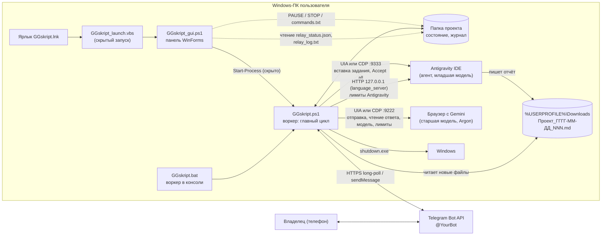
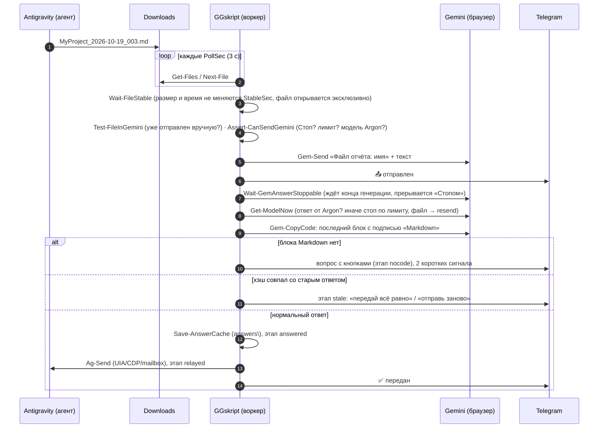
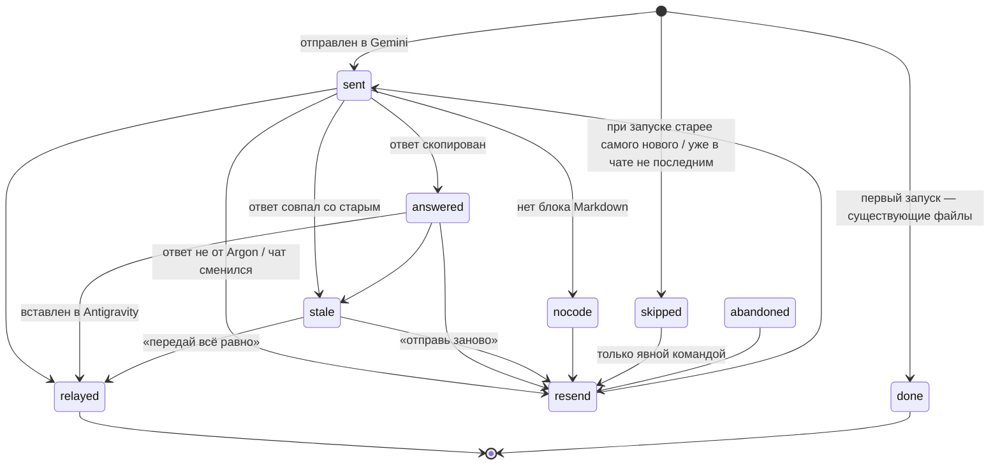

# GGskript v2 — архитектура

Документ для инженера: из чего состоит программа, как идут данные и как она связана с внешним миром.
Основано на коде в `lib\*.ps1`, `GGskript.ps1`, `GGskript_gui.ps1` (состояние на 19.10.2026, пункты плана 1–29).

## 1. Компоненты

| Компонент | Файл | Роль |
|---|---|---|
| Запускатор | `GGskript_launch.vbs` | Запускает панель скрыто (`powershell -STA -WindowStyle Hidden`), путь — от своего расположения |
| Панель | `GGskript_gui.ps1` + `lib\Gui.Core.ps1` | Кнопки Старт/Стоп/Выключить/Лимиты/Статус/Accept All/Скриншот/Открыть папку, хвост журнала, строка команды. С воркером общается только через файлы |
| Воркер | `GGskript.ps1` | Загружает `lib\*.ps1`, настройки, состояние; тестовые режимы `-test*`; главный цикл `Invoke-MainStep` |
| Логика передачи | `lib\Relay.ps1` | Очередь файлов, отправка в Gemini, ожидание ответа, передача в Antigravity, лимиты, автовозобновление, протокол запуска, команды, блокирующие окна |
| Gemini | `lib\Gemini.ps1` (фасад `Gem-*`), `lib\Gemini.Uia.ps1`, `lib\Gemini.Cdp.ps1` | Два транспорта с одинаковым интерфейсом и безопасным откатом CDP→UIA |
| Antigravity | `lib\Antigravity.ps1` (UIA, почтовый ящик, `Ag-Send`), `lib\Antigravity.Cdp.ps1` | Безопасная вставка: проверка зависания, чужого текста, занятости агента |
| Telegram | `lib\Telegram.ps1`, `lib\Chat.ps1` | Токен (DPAPI), опрос, отправка, кнопки, вопросы с подтверждением |
| Выключение ПК | `lib\Shutdown.ps1` | План в `relay_shutdown.json`, подтверждение, вызов `shutdown.exe` |
| Платформа | `lib\Platform.Win.ps1`, `lib\Uia.ps1` | WinAPI (окна, фокус, клавиатура, буфер, DPI, мьютексы, DPAPI, скриншот), обёртки UI Automation |
| Ядро | `lib\Core.ps1`, `lib\State.ps1` | Чистая логика без Windows: настройки, разбор команд, парсеры лимитов, выбор блока кода; атомарная запись, этапы файлов, журнал |

## 2. Цикл передачи (один файл)

Главный цикл (`Invoke-MainStep`, `lib\Relay.ps1`), по порядку на каждом шаге:

1. `Pump` — опрос Telegram, просроченные вопросы, таймер выключения, `commands.txt`, файл `PAUSE`/клавиши P/S, запись `relay_status.json`.
2. Файл `STOP` → выход из цикла.
3. «Стоп» (`PAUSE`) → `Invoke-StoppedStep`: только Telegram и таймер выключения; лимиты, модель и окна **не трогаются** (пункт 25B).
4. `Check-Blocking` — не закрыло ли что-то окно (диалоги; разрешённые — из `blocking_allowlist` в `relay_config.json`).
5. Очередь команд (`$script:Queue`): действия из Telegram/ПК выполняются **между** шагами передачи, не посреди неё.
6. Раз в `QuotaEveryMin` (10 мин) — лимиты (`Check-Quotas`), план автовозобновления.
7. Если нужен протокол запуска (`NeedStart`) — `Start-Procedure`, повтор каждые `StartRetrySec`.
8. Остановка по лимиту/модели → ждать сброса (`Invoke-AutoResume`), иначе `Next-File` → `Process-File`.

## 3. Этапы файла (машина состояний)

Хранятся в `relay_state.json` (`files.<имя>.stage`), переходы проверяет `Test-StageTransition` (`lib\State.ps1`).

Терминальные этапы: `relayed`, `nocode`, `done`, `abandoned`, `skipped`. Хэши переданных ответов (`hashes`, до `HashKeep`=200) защищают от повторной передачи одного и того же ответа. Ответ, скопированный, но не подтверждённый в Antigravity, лежит в `answers\<имя>` и после перезапуска передаётся без повторного запроса к Gemini.

## 4. Протокол запуска (пункт 25A, `Start-Procedure`)

Выполняется при запуске и после каждого «Старт». Строго по порядку; каждый шаг — строка отчёта в Telegram и журнале. `-teststart` — то же «всухую».

1. **Окна**: Gemini (поле ввода) и Antigravity. Нет окна → повтор через `StartRetrySec` (60 с), ход ничей.
2. **Лимиты**: страница usage Gemini и квоты Antigravity. Исчерпан → ждать сброса.
3. **Модель** Gemini: должна содержать `ModelMustContain` (Argon); иначе переключить (`AutoSwitchModel`) или остановиться. Gemini генерирует / Antigravity завис → повтор.
4. **Файлы** (пункт 24): берётся только **самый новый** по времени изменения (при равенстве — по номеру), старые необработанные → `skipped`. Новый файл, которого нет в чате Gemini, — вопрос в Telegram (`StartupAskNewest`).
5. **Сверка чатов**: последний отчёт в чате Gemini (по «Файл отчёта:», имени вложения или содержимому, пункты 27C/28) против Downloads и чата Antigravity → чей ход: Gemini (ждать ответ), Antigravity (агент работает) или GGskript (передать).

## 5. Связи с внешним миром

| Внешняя система | Как | Где в коде |
|---|---|---|
| **Telegram Bot API** | HTTPS `api.telegram.org/bot<токен>/…`: `getUpdates` (опрос, offset в `relay_tg_offset.txt`), `sendMessage`, `editMessageText`, `answerCallbackQuery`, `sendDocument`, `sendPhoto`. Только `chat_id` владельца, кнопки — тоже | `Invoke-Tg`, `Poll-Tg`, `Tg-Send*`, `Invoke-TgUpload` (`lib\Telegram.ps1`) |
| **Gemini, UIA** | Окно Chromium-браузера (`chrome`, `browser` = Яндекс, `msedge`; класс `Chrome(_Yandex)?_WidgetWin_1`), вкладка «Gemini». Ввод — фокус + буфер + Ctrl+V + Enter (буфер пользователя восстанавливается), чтение — дерево UI Automation, копирование кода — кнопка «Копировать код» блока «Markdown» | `lib\Gemini.Uia.ps1`, `lib\Platform.Win.ps1`, `lib\Uia.ps1` |
| **Gemini, CDP** | `http://127.0.0.1:9222/json` → WebSocket вкладки `gemini.google.com`. `Input.insertText`, `Runtime.evaluate` (один JS-помощник, данные — JSON), вкладка `/usage` читается в фоне (`Page.reload`) | `lib\Gemini.Cdp.ps1` |
| **Antigravity, UIA** | Окно процесса `Antigravity IDE`, поле `Message input`; проверки: окно не зависло (WM_NULL, IsHungAppWindow), поле пустое и не меняется, агент не занят | `lib\Antigravity.ps1` |
| **Antigravity, CDP** | `127.0.0.1:9333` (Electron DevTools): вставка `Input.insertText`, Enter, клики `click()` в DOM. Кнопки Cancel/Отмена/Stop не нажимаются никогда; при занятом агенте не отправляет | `lib\Antigravity.Cdp.ps1` |
| **Antigravity, лимиты** | Процесс `language_server*` → `--csrf_token` из командной строки и его порт → POST `http://127.0.0.1:<порт>/exa.language_server_pb.LanguageServerService/RetrieveUserQuotaSummary` (и `GetUserStatus`). Недокументированный внутренний API | `Find-AgServers`, `Ag-Rpc`, `Get-AgQuota` (`lib\Relay.ps1`) |
| **Antigravity, почтовый ящик** | `AgTransport=mailbox`: задание в `inbox\task_<имя>.md`, в чат — короткая ссылка; подтверждение `.taken`/`.ack` | `AgMailbox-Send`, `Check-MailboxAcks` |
| **Папка «Загрузки»** | `%USERPROFILE%\Downloads`, шаблон `Pattern` = `<Проект>_<ГГГГ-ММ-ДД>_<NNN>.md`, файлы раньше `IgnoreBefore` не берутся | `Get-Files`, `Wait-FileStable` |
| **Windows shutdown.exe** | `shutdown /s /t 0` в назначенное время (по умолчанию) или таймер `/s /f /t N` (`ShutdownForce`), отмена `/a`. Всегда с подтверждением в Telegram | `lib\Shutdown.ps1`, `Invoke-ShutdownExe` |
| **Планировщик заданий** | Код GGskript задач не создаёт. Используется только вручную/оператором для запуска в интерактивном сеансе: `wscript "<папка>\GGskript_launch.vbs"`, задача удаляется после запуска | — |
| **DPAPI** | `ConvertTo-SecureString`/`ConvertFrom-SecureString` (CurrentUser): `tg_token.dpapi` | `Protect-Secret`, `Unprotect-Secret`, `Set-TgToken.ps1` |
| **Динамик** | `[Console]::Beep` по шаблонам (`Get-SoundPattern`), не чаще `SoundRepeatMin`; в тестах `GG_NO_BEEP=1` | `Play-Sound`, `Invoke-Beep` |
| **git** (необязательно) | `GitCheckpointRepo`: коммит перед «Accept all» | `Invoke-GitCheckpoint` |

## 6. Транспорты и откат

`GeminiTransport` = `uia` | `cdp`; `AgTransport` = `uia` | `cdp` | `mailbox`. Фасады `Gem-*` (`Use-GemTransport`) и `Ag-Send` выбирают транспорт. Откат CDP→UIA допустим **только** если CDP недоступен (`Test-CdpUnreachable`: нет порта, нет вкладки, обрыв связи) и для отправки — только если текст **точно не отправлен** (`GG.RelayNotSentException`). Об откате — одно сообщение в Telegram, о восстановлении — тоже.

Ошибки типизированы (`lib\Core.ps1`): `RelayStopException`, `RelayLimitException`, `RelayStaleException`, `RelayNoCodeException`, `RelayPausedException`, `RelayNotSentException`, `AgBlockedException` (hung | nowindow | foreign | unknown). `Get-ErrorKind` превращает их в решение цикла.

## 7. Обмен между панелью и воркером

Только через файлы в папке проекта: `PAUSE` (есть — «Стоп»), `STOP` (создать — воркер выходит и удаляет файл), `commands.txt` (строки команд; воркер переименовывает в `.proc`, читает, удаляет; UTF-8 или cp866), `relay_status.json` (снимок состояния раз в 1,5 с), `relay_log.txt` (панель читает хвост). Жив ли воркер — по мьютексу `Local\GGskript_Worker`, запасной признак — свежий `relay_status.json` и живой pid.

## 8. Безопасность

- Порты отладки 9222 (Chrome/Яндекс для Gemini) и 9333 (Antigravity) слушают **только 127.0.0.1** (`--remote-debugging-address=127.0.0.1`, `--remote-allow-origins=http://127.0.0.1:PORT`). Но пока они открыты, **любая локальная программа** этого ПК может управлять этим профилем браузера и Antigravity. Поэтому для Gemini — отдельный профиль в `%LOCALAPPDATA%\GGskript\…`, а не основной браузер.
- Токен Telegram — только в `tg_token.dpapi` (DPAPI, пользователь + ПК). Открытый `telegram_token` в `relay_config.json` поддерживается с предупреждением. В журнал токен не пишется.
- Команды и кнопки принимаются только от `chat_id` владельца; опасные команды (стоп/прими/старт) в строгом режиме — только точной формой (`StrictCommands`); выключение ПК и «выключи скрипт» — с подтверждением.
- Системные окна (UAC, учётные данные, Secure Desktop) не нажимаются никогда (`Test-ForbiddenWindow`).
- Внутри Gemini/Antigravity GGskript не нажимает кнопки отмены/остановки агента.
