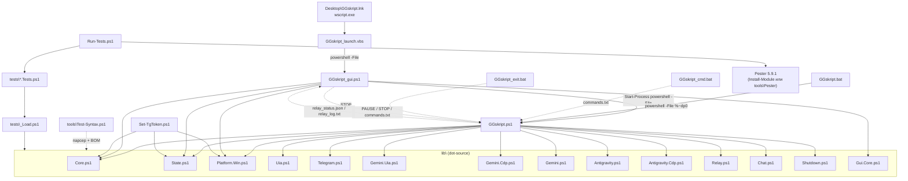
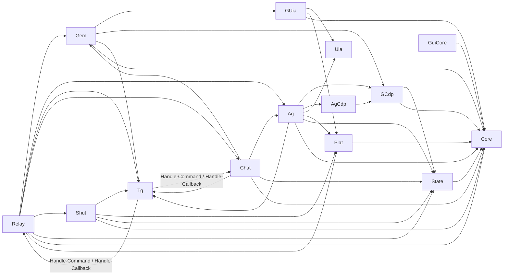

# GGskript v2 — зависимости

## 1. Кто кого загружает и запускает

Модули подключаются dot-source (`. (Join-Path $Root 'lib\X.ps1')`) в общую область скрипта. Функции разрешаются в момент вызова, поэтому порядок загрузки важен только для кода верхнего уровня модулей (типы `GG.*` в `Core.ps1`, `GG.Native` в `Platform.Win.ps1`).

## 2. Вызовы между модулями

Пояснения:
- `Antigravity.Cdp.ps1` использует транспорт CDP из `Gemini.Cdp.ps1` (`Cdp-HttpJson`, `Cdp-Open`, `Cdp-Close`, `Invoke-Cdp`) с другим портом (`AgCdpPort`); `Ag-Send` решает об откате на UIA через `Test-CdpUnreachable`.
- `Telegram.ps1` ↔ `Relay.ps1`/`Chat.ps1` — взаимная зависимость: `Poll-Tg` передаёт текст в `Handle-Command`, кнопки — в `Handle-Callback`; обратно все модули шлют сообщения через `Tg-Send`/`Notify`.
- Глобальные объекты, общие для модулей: `$Cfg` (настройки), `$script:St` (состояние), `$script:Queue` (очередь команд), `$script:Paused`, `$script:Q` (последние лимиты).
- Единые «узкие места» для побочных эффектов (подменяются в тестах): `Invoke-Tg`, `Invoke-TgUpload`, `Get/Set-ClipText`, `Save/Restore-Clipboard`, `Save-ScreenshotJpeg`, `Send-Screenshot`, `Protect/Unprotect-Secret`, `Invoke-ShutdownExe`, `Invoke-Beep`.

## 3. Пути: от чего считаются

| Что | Откуда путь |
|---|---|
| Все файлы состояния, журнал, `answers\`, `inbox\`, `PAUSE`, `STOP`, `commands.txt`, токен, конфиги | `Get-DefaultSettings -Root $PSScriptRoot` — папка, где лежит `GGskript.ps1` / `GGskript_gui.ps1` |
| `.bat` | `%~dp0` (папка самого `.bat`) |
| `GGskript_launch.vbs` | `WScript.ScriptFullName` |
| Отчёты | `%USERPROFILE%\Downloads` (`Downloads`) |
| Профили браузера для Gemini | `%LOCALAPPDATA%\GGskript\…` |
| Antigravity | `%LOCALAPPDATA%\Programs\Antigravity IDE\Antigravity IDE.exe` (или `…\Antigravity\Antigravity.exe`) |
| Chrome / Яндекс / Edge | `%ProgramFiles%`, `%ProgramFiles(x86)%`, `%LOCALAPPDATA%` |

Единственное место с абсолютным путём к проекту — **ярлык** `%USERPROFILE%\Desktop\GGskript.lnk` (цель, рабочая папка, значок). Тест `tests\Item29.Paths.Tests.ps1` следит, чтобы в коде и настройках такого пути не было.

## 4. Внешние зависимости

| Зависимость | Версия / требования | Для чего | Где |
|---|---|---|---|
| Windows | 10/11 (Per-Monitor V2 DPI с 1703; иначе system-aware) | Всё | — |
| Windows PowerShell | 5.1 (Desktop). Код совместим и с PowerShell 7 (тесты на Linux) | Среда выполнения; `.ps1` в UTF-8 с BOM | все `.ps1` |
| .NET Framework 4.x | `UIAutomationClient`, `UIAutomationTypes`, `System.Windows.Forms`, `System.Drawing`, `System.Net.Http`, `System.Net.WebSockets.ClientWebSocket` | UIA, панель, скриншоты, загрузка файлов в Telegram, CDP | `Uia.ps1`, `GGskript_gui.ps1`, `Platform.Win.ps1`, `Telegram.ps1`, `Gemini.Cdp.ps1` |
| WinAPI | `user32.dll` (окна, фокус, ввод, буфер, WM_NULL), `kernel32.dll`, `dwmapi.dll` | Окна и ввод | `Platform.Win.ps1` (`GG.Native`) |
| CIM / NetTCPIP | `Get-CimInstance Win32_Process`, `Get-NetTCPConnection` | Найти language_server Antigravity и его порт | `Find-AgServers` |
| DPAPI | `ConvertTo/From-SecureString` (модуль Microsoft.PowerShell.Security; `Repair-PSModulePath` чинит путь модулей, если 5.1 запущен из pwsh 7) | Токен Telegram | `Platform.Win.ps1`, `Set-TgToken.ps1` |
| Windows-утилиты | `shutdown.exe`; в `.bat` — `netstat`, `tasklist`, `findstr`, `timeout` | Выключение ПК; проверка портов | `Shutdown.ps1`, `Start-*.bat` |
| Pester | 5.9.1: `Install-Module Pester -RequiredVersion 5.9.1 -Scope CurrentUser` (подойдёт 5.5–5.99; локальная копия в `tools\Pester` — необязательно, в git не входит) | Тесты | `Run-Tests.ps1` |
| Браузер для Gemini | Google Chrome (136+: порт отладки только с отдельным `--user-data-dir`), Яндекс Браузер, Microsoft Edge | Gemini (`gemini.google.com`), режим Argon, страница `/usage` | `Gemini.*.ps1`, `Start-Gemini*.bat` |
| Antigravity IDE | Electron; селекторы по версии 1.107 (`Message input`, `send-button`, `Cancel (Ctrl+D)`); внутренний API language_server | Агент, квоты | `Antigravity*.ps1`, `Relay.ps1` |
| Telegram | Бот **@YourBot**, Bot API по HTTPS (TLS 1.2), доступ в интернет | Управление и уведомления | `Telegram.ps1` |
| git | необязательно (`GitCheckpointRepo`) | Коммит перед Accept all | `Relay.ps1` |
| Проект агента (например, MyProject) | Пишет отчёты по шаблону `<Проект>_<ГГГГ-ММ-ДД>_<NNN>.md` в Downloads | Источник отчётов | — |
